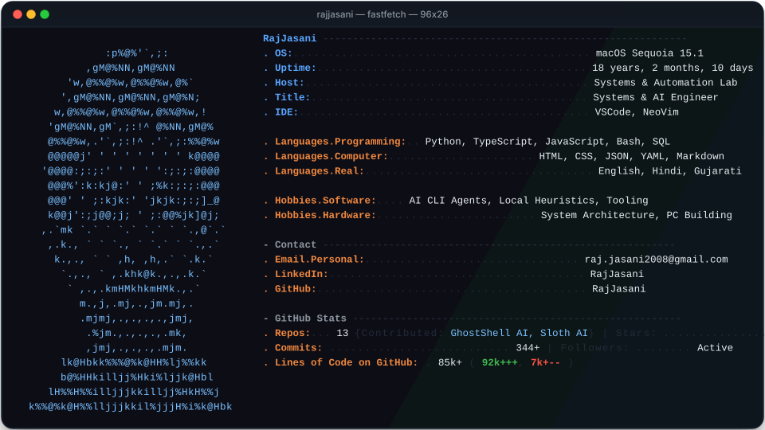

  

 

  

    <code>Autonomous CLI Systems</code> • <code>Heuristic Engines</code> • <code>Open Source Infrastructure</code>
  

  

    
    
    
  

---

### ⚡ Overview

I am an open-source software engineer building autonomous agent architectures, developer command-line tools, and modular systems. My work focuses on deterministic local heuristics, safe process execution, and reducing latency in developer workflows.

- 🛠️ Currently developing **[GhostShell AI](https://github.com/RajJasani/ghostshell-ai)** — an autonomous terminal environment with sandbox isolation and semantic intent synthesis.
- 🧪 Engineered **[Sloth Tidy AI](https://github.com/RajJasani/sloth-tidy-ai)** — a privacy-conscious local heuristic classification and automated file intelligence agent.
- 🎯 Active open-source builder across Hacktoberfest and MLH hackathons.
- 💡 Core focus: Systems reliability, LLM agent tool calling, and unix command orchestration.

---

### 📦 Key Projects

<table>
  <tr>
    <td width="50%" valign="top">
      <h4><a href="https://github.com/RajJasani/ghostshell-ai">🛡️ GhostShell AI</a></h4>
      

        Autonomous agentic CLI environment for terminal workflows. Combines real-time command sandboxing, heuristic threat inspection, and generative shell workflows.
      

      

        <code>Python</code> • <code>CLI Architecture</code> • <code>Sandboxing</code> • <code>Agentic AI</code>
      

    </td>
    <td width="50%" valign="top">
      <h4><a href="https://github.com/RajJasani/sloth-tidy-ai">🦥 Sloth Tidy AI</a></h4>
      

        Local-first workspace intelligence engine. Uses rule-based categorization and lightweight heuristics to organize assets with zero data exfiltration.
      

      

        <code>Python</code> • <code>Heuristics</code> • <code>File Automation</code> • <code>Privacy-First</code>
      

    </td>
  </tr>
</table>

---

### 📊 Real-Time GitHub Telemetry & Data Sync

  <table border="0">
    <tr>
      <td width="50%" align="center">
        
      </td>
      <td width="50%" align="center">
        
      </td>
    </tr>
    <tr>
      <td colspan="2" align="center">
        
      </td>
    </tr>
  </table>

---

### 🛠️ Technical Stack & Tooling

| Domain | Technologies & Systems |
| :--- | :--- |
| **Languages** | Python, JavaScript (ES6+), TypeScript, Bash/Shell, SQL |
| **AI & Automation** | Agentic Tool Calling, Heuristic Classification, LLM Orchestration, Prompt Design |
| **Backend & APIs** | FastAPI, Node.js, Express, REST Architecture, Process Sandboxing |
| **DevOps & Tooling** | Git, GitHub Actions, Docker, Linux/Unix Internals, Vite |

---

  Engineered by <a href="https://github.com/RajJasani">Raj Jasani</a> • Open-Source Builder

