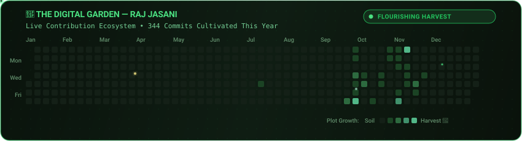

  

 

  
   
  

    <code>Autonomous CLI Systems</code> • <code>Heuristic Engines</code> • <code>Open Source Ecosystems</code>
  

  

    
    
    
  

---

### 🌱 The Digital Garden

Software is living infrastructure. I treat codebases as digital gardens — planting resilient architectures, tending local heuristics, pruning accidental complexity, and cultivating open-source tools that respect user autonomy.

- 🌿 **Current Nursery**: Architecting **[GhostShell AI](https://github.com/RajJasani/ghostshell-ai)** — an autonomous terminal assistant with sandboxed execution and semantic intent synthesis.
- 🪴 **Planted & Growing**: Cultivated **[Sloth Tidy AI](https://github.com/RajJasani/sloth-tidy-ai)** — an offline-first workspace intelligence engine relying on lightweight rule heuristics with zero data exfiltration.
- 🌾 **Active Pollination**: Contributing across Hacktoberfest and MLH hackathons with a focus on accessible tools and developer experience.
- ☀️ **Cultivation Philosophy**: Deterministic heuristics over unnecessary bloat, low-latency execution, and sustainable system design.

---

### 🐛 The Contribution Garden Plot

  

  🌱 <i>Animated Garden Crawler tending 344+ commits across the 2026 seasons.</i>

---

### 📦 Key Ecosystem Projects

<table>
  <tr>
    <td width="50%" valign="top">
      <h4><a href="https://github.com/RajJasani/ghostshell-ai">🛡️ GhostShell AI</a></h4>
      

        Autonomous agentic CLI environment for terminal workflows. Combines real-time command sandboxing, heuristic threat inspection, and generative shell workflows.
      

      

        <code>Python</code> • <code>CLI Architecture</code> • <code>Sandboxing</code> • <code>Agentic AI</code>
      

    </td>
    <td width="50%" valign="top">
      <h4><a href="https://github.com/RajJasani/sloth-tidy-ai">🦥 Sloth Tidy AI</a></h4>
      

        Local-first workspace intelligence engine. Uses rule-based categorization and lightweight heuristics to organize assets with zero data exfiltration.
      

      

        <code>Python</code> • <code>Heuristics</code> • <code>File Automation</code> • <code>Privacy-First</code>
      

    </td>
  </tr>
</table>

---

### 📊 Real-Time Garden Telemetry & Data Sync

  <table border="0">
    <tr>
      <td width="50%" align="center">
        
      </td>
      <td width="50%" align="center">
        
      </td>
    </tr>
    <tr>
      <td colspan="2" align="center">
        
      </td>
    </tr>
  </table>

---

### 🌿 Botanical Tooling & Engineering Stack

| Soil & Layer | Cultivated Technologies |
| :--- | :--- |
| **Languages** | Python, JavaScript (ES6+), TypeScript, Bash/Shell, SQL |
| **AI & Automation** | Agentic Tool Calling, Heuristic Classification, LLM Orchestration, Prompt Design |
| **Backend & Stems** | FastAPI, Node.js, Express, REST Architecture, Process Sandboxing |
| **DevOps & Sunlight** | Git, GitHub Actions, Docker, Linux/Unix Internals, Vite |

---

  Tended with care by <a href="https://github.com/RajJasani">Raj Jasani</a> • Open-Source Digital Gardener

